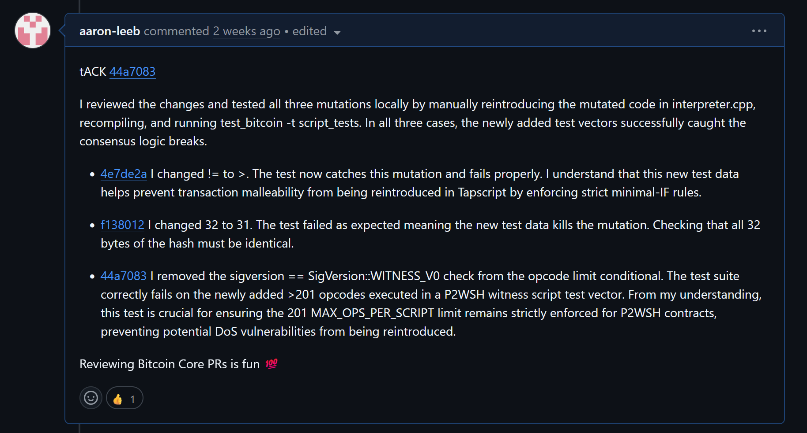

After cloning, building, and running the test suites for Bitcoin Core, the next step is to become more familiar with the codebase. I have been watching the project from a distance, and running my own full node with every intention to contribute for years now, but for whatever reason I built up an artificial barrier to entry.  I think this might be more common among the technical bitcoin crowd than is acknowledged. I can only speak for myself when I say that I believe it originated from the pedestal that I put Bitcoin on. I have been learning about how Bitcoin is perfect money and a technical innovation for 5+ years, but at some point I just had to get my hands dirty. For those hesitant or feeling like you need to understand the technical complexities of Bitcoin more before contributing, you're wrong.

Start small. One of the best places to start is by reviewing pull requests (PRs). Especially PRs that involve changes to tests. These are great because they have no direct impact on changing consensus. I say no "direct" impact because they don't directly change the code that runs on the node; orchestrating the P2P network, validating transactions and blocks, or creating wallets, but without good tests future changes to the consensus code could introduce bugs that go unnoticed.

While looking through the open PRs, I found https://github.com/bitcoin/bitcoin/pull/36128, which adds Bitcoin script test cases to the codebase to kill mutants. It sounded interesting, but I didn't understand what it was doing. There is no better way to learn than to review other people's work. If you're anything like I was prior to understanding the context of the PR, you're probably wondering what a mutant is and why we're killing them. For those that are fans of Marvel, no this isn't X-Men. Mutants are essentially a copy of the source code that contains a small, deliberate change used to test the quality and coverage of your test suite. For anyone familiar with software testing that probably makes sense. If not, bare with me as I explain in more depth how I verified the mutants were dead.

### Reviewing an Open PR on Bitcoin Core

I started the review process by reading the PR description. From the description, I was able to gather that there were three commits which added test cases to the Bitcoin Core codebase that weren't previously covered by the test suites, making them live mutants. The contributor also encouraged validation and review for each commit. All of the mutants found by this contributor's [custom mutant harness](https://github.com/ViniciusCestarii/mutant-harness) were identified in src/script/interpreter.cpp. I had no idea of the significance of the file prior to reviewing this PR, but it's arguably one of the most critical files for network security. 

*Note: When you decide to start contributing to Bitcoin Core, [Contributing.md](https://github.com/bitcoin/bitcoin/blob/master/CONTRIBUTING.md) outlines the guidelines in more depth. Each logical change should have its own dedicated commit for clarity and simplicity*

To put it plainly, it's the engine that evaluates Bitcoin Script. Bitcoin Script is the programming language responsible for securing and verifying ownership of users funds. Every time a transaction occurs, a programmatic puzzle matching a cryptographic key to a lock must be solved. The interpreter.cpp file is the judge that executes that puzzle. If a bug here accidentally evaluates an invalid script as true, someone could steal funds. If it evaluates a valid script as false, funds are frozen forever. That's why proving these mutants are dead is not just good practice. It's critically important for the network!

In order to validate the test cases being proposed in the PR, I needed to run the tests locally. I did this by running a series of commands to checkout the PR:

*Note: this is assuming you have already cloned the repo and configured the master branch as a remote named upstream*

```
# Make sure your local repository is up to date
git fetch upstream

# Fetch the specific pull request into a new local branch named 'pr-36128'
git fetch upstream pull/36128/head:pr-36128

# Switch to your new local branch to start reviewing
git checkout pr-36128
```

Once I checked out the PR locally, I ran the build and functional tests with the following commands:

```
# Build the binaries using CMake from the root of the repository
cmake --build build -j$(nproc) 

# Run the full Python functional test suite 
./test/functional/test_runner.py -j$(nproc)
```

These were my initial checks to make sure the changes made by the PR didn't cause any regression in the codebase. I then moved on to inspect the code changes on the branch to help me understand what the changes were meant to accomplish. I looked at the test data added in the first commit ([4e7de2a](https://github.com/bitcoin/bitcoin/commit/4e7de2ac4cc6c08ff27620de01ccd9d66c568459)) and the mutant it was meant to kill. Since this was my first PR review for Bitcoin Core, I utilized AI to help me understand the context and reason for the added test data. 

### The Mutant Identified

To summarize in my own words and understanding, prior to the introduction of Tapscript in 2021, Bitcoin Script was very flexible about what was considered True and False. In a conditional check for 0 by the interpreter, it could be represented in multiple ways, such as an empty array, a single byte of zero, or even multiple bytes of zeros causing malleability.

Tapscript was introduced with Taproot to make Bitcoin Script more efficient and less ambiguous. As part of Tapscript, a strict rule called MINIMALIF is enforced where OP_IF and OP_NOTIF conditional statements only accept two exact inputs:

- True: A one byte vector containing exactly 0x01

- False: A completely empty vector `[]`. 

Any other input must cause the script to fail immediately.

This can be found in src/script/interpreter.cpp lines 624-630 seen below:

```
// Tapscript requires minimal IF/NOTIF inputs as a consensus rule.

if (sigversion == SigVersion::TAPSCRIPT) {

	// The input argument to the OP_IF and OP_NOTIF opcodes must be either

	// exactly 0 (the empty vector) or exactly 1 (the one-byte vector with value 1).

	==🟡if (vch.size() > 1 || (vch.size() == 1 && vch[0] != 1))== {

		return set_error(serror, SCRIPT_ERR_TAPSCRIPT_MINIMALIF);

	}

}
```

The reason for the addition of the test data was that the conditional highlighted above was a blind spot for the test suites. The mutation that went uncaught was included in the PR:

```
diff --git a/src/script/interpreter.cpp b/src/script/interpreter.cpp
index 98b16ec..f9b08fe 100644
--- a/src/script/interpreter.cpp
+++ b/src/script/interpreter.cpp
@@ -624,7 +624,7 @@ bool EvalScript(std::vector<std::vector<unsigned char> >& stack, const CScript&
-                        if (vch.size() > 1 || (vch.size() == 1 && vch[0] ==🟡!=== 1)) {
+                        if (vch.size() > 1 || (vch.size() == 1 && vch[0] ==🟡>== 1)) {
```

The original code checked if a one byte input was **not equal to one**. If it was anything other than one, it rejected it.

The mutant changed the logic to check if the input was **greater than one**.

This created a dangerous loophole. Because zero is not greater than one, the mutated code would look at a one byte zero (`0x00`), fail to recognize it as a rule violation, and accidentally accept it as a valid input. If a node ran this mutated code, it would accept transactions that the rest of the network would reject, causing the node to branch off onto its own invalid blockchain.
### Understanding the Test Data

To prove the mutant is dead, the PR author added two test cases to the test suite. Here is what the JSON array translates to for the Bitcoin virtual machine:

- **`"00"`:** **This is the malicious input**. It represents a one byte vector containing `0x00`. The test pushes this onto the stack right before the script runs.

- **`"#SCRIPT# IF 1 ENDIF"` and `"#SCRIPT# NOTIF 1 ENDIF"`:** This is the Tapscript being tested. It takes that `00` from the stack and evaluates it using the conditional operators.

- **`"0x51 0x20 #TAPROOTOUTPUT#"`:** This is the locking script indicating that this is a Taproot transaction. This tells the engine it must enforce Tapscript rules.

- **`"P2SH,WITNESS,TAPROOT"`:** These are the evaluation flags that explicitly turn on the strict Taproot consensus checks for the test.

- **`"TAPSCRIPT_MINIMALIF"`:** This is the expected error code and the most important part of the test. The test runner expects the transaction to throw a fatal error.

### How it Kills the Mutant

When the unmutated Bitcoin Core engine encounters the `00` input, it realizes it violates the strict MINIMALIF rule and throws the `TAPSCRIPT_MINIMALIF` error. Since this matches the expected outcome declared in the JSON, the test passes.

 If you inject the mutant, the engine encounters the `00` input, incorrectly evaluates it as a valid False, and finishes the script without throwing an error. Because the expected `TAPSCRIPT_MINIMALIF` error never happens, the test runner throws a massive red flag and fails.
 
 The mutant is caught and killed.

Of course, I could have just taken Gemini's word for it and given a stamp of approval to the change, but that is not the open source way. Instead, I reintroduced the mutant to the code and removed the addition of the test data. I then rebuilt the project. Since this was my first time reviewing a PR, I was unsure how to run the unit tests found in the Bitcoin Core project.

The command to run C++ unit tests:
```
./build/bin/test_bitcoin -t <test_name>
```
 
In the case of this mutant, I ran the script_tests unit test:
```
./build/bin/test_bitcoin -t script_tests
```

Since I had reintroduced the mutant and removed the test data, the test didn't fail. 

I then added the test data and rebuilt with the code still mutated. When I ran the unit test again, this time it failed, verifying that the test data triggered the `TAPSCRIPT_MINIMALIF` error. 

Finally, I corrected the code and rebuilt. I ran the unit test again and the test passed.

I then replicated this procedure for the other two commits on the PR and left my first comment on the PR:



That's how I verified the mutants were dead.